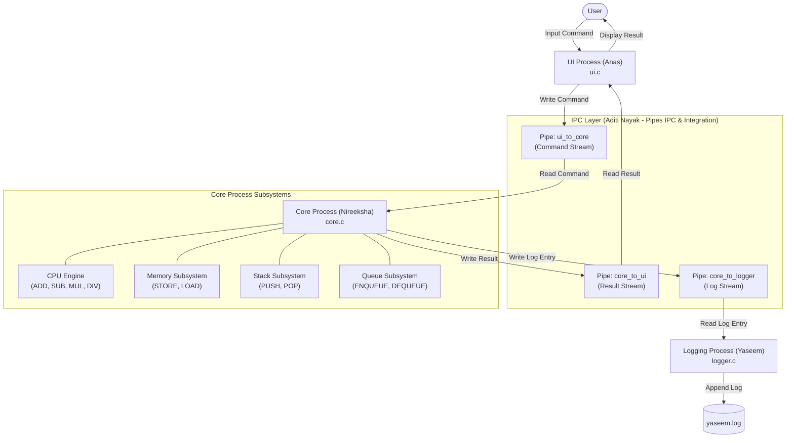

# Operating Systems PBL Simulators Repository

Welcome to the **Operating Systems Project-Based Learning (PBL)** repository developed by **Aditi Nayak** (Team Leader) and team members **Anas Ahmed**, **Nireeksha**, and **Yaseem**.

This repository contains two complete, production-grade OS simulation systems implemented in C:
1. **Week 2: Multi-Process System Simulator** (Three independent processes communicating via POSIX Pipes IPC).
2. **Week 3: Process Scheduling Simulator** (Six CPU scheduling algorithms, ASCII Gantt charts, per-process metrics, and automated test harness).

---

## Team Members & Responsibilities

| Team Member | Project Role | Week 2 Technical Contribution | Week 3 Technical Contribution |
|:---|:---|:---|:---|
| **Aditi Nayak** *(Team Leader)* | **Lead Architect & Integration Engineer** | **POSIX Pipes IPC** coordinator, pipe lifecycle management (`pipe()`, `fork()`, `close()`, `waitpid()`), descriptor hygiene, end-to-end integration | **Unified Scheduling Architecture**, data structures (`Process`, `Gantt`, `Seg`), interactive menu orchestrator (`main.c`), dataset clone engine, automated test suite (`test_runner.c`) |
| **Anas Ahmed** | Computational & Time-Sliced Scheduling | **UI Process** (`ui.c`) with interactive terminal REPL and command validation | **Input Module** (`input.c`), **FCFS** (`fcfs.c`), and **Round Robin** (`rr.c`) with configurable time quantum and ready queue |
| **Nireeksha** | Subsystems & Execution Engine | **Core Process** (`core.c`) implementing CPU engine, Memory subsystem, Stack, and Queue | **Non-preemptive SJF**, **Preemptive SRTF** (`sjf.c`), and **ASCII Gantt Chart** renderer with IDLE interval support (`gantt.c`) |
| **Yaseem** | Logging & Metrics Engine | **Logging Process** (`logger.c`) with file persistence daemon (`yaseem.log`) | **Non-preemptive Priority**, **Preemptive Priority** (`priority.c`), and statistical metrics computation (WT, TAT, RT, CPU Util, Throughput) |

---

# Part 1: Week 3 — Process Scheduling Simulator

The Week 3 simulator models how modern operating systems schedule ready processes onto the CPU under six classic scheduling disciplines.

### Supported Scheduling Algorithms
1. **First-Come, First-Served (FCFS)** (Non-preemptive)
2. **Shortest Job First (SJF)** (Non-preemptive)
3. **Shortest Remaining Time First (SRTF)** (Preemptive SJF)
4. **Priority Scheduling (Non-preemptive)** ($1 = \text{Highest Priority}$)
5. **Priority Scheduling (Preemptive)** ($1 = \text{Highest Priority}$)
6. **Round Robin (RR)** (Configurable Time Quantum $q$)

### System Architecture & Data Model

```
+-------------------------------------------------------------------------+
|                                main.c                                   |
|                (Interactive Menu Orchestrator - Aditi)                  |
+--------------------+---------------------+--------------------+---------+
                     |                     |                    |
        +------------v-----------+   +-----v------+   +---------v---------+
        |        input.c         |   |  gantt.c   |   |    Algorithms     |
        |  (Input Parser - Anas) |   |  (Nireek   |   |   (All Members)   |
        |                        |   |  & Yaseem) |   |                   |
        +------------------------+   +------------+   +---------+---------+
                                                                |
           +----------------+----------------+------------------+-----------------+
           |                |                |                  |                 |
     +-----v-----+    +-----v-----+    +-----v-----+      +-----v-----+     +-----v-----+
     |  fcfs.c   |    |   sjf.c   |    | priority.c|      |   rr.c    |     |test_runner|
     |  (Anas)   |    | (Nireek)  |    | (Yaseem)  |      |  (Anas)   |     |  (Aditi)  |
     +-----------+    +-----------+    +-----------+      +-----------+     +-----------+
```

### Key Performance Formulas
- **Turnaround Time ($TAT$):** $TAT = CT - AT$
- **Waiting Time ($WT$):** $WT = TAT - BT$
- **Response Time ($RT$):** $RT = \text{First CPU Start Time} - AT$
- **CPU Utilization ($\%$):** $\left(\frac{\sum BT}{\text{Total Time}}\right) \times 100\%$
- **Throughput:** $\frac{N}{\text{Total Time}}$

### Performance Comparison on Standard Reference Dataset
*(P1: AT=0, BT=5, Prio=2 | P2: AT=1, BT=3, Prio=1 | P3: AT=2, BT=1, Prio=3 | P4: AT=3, BT=2, Prio=4)*

| Algorithm | Avg WT | Avg TAT | Avg RT | Total Time | CPU Utilization |
|:---|:---:|:---:|:---:|:---:|:---:|
| **FCFS** | 4.00 | 6.75 | 4.00 | 11 | 100.00% |
| **SJF (Non-preemptive)** | 3.25 | 6.00 | 3.25 | 11 | 100.00% |
| **SRTF (Preemptive SJF)** | **3.00** | **5.75** | **1.50** | 11 | 100.00% |
| **Priority (Non-preemptive)** | 3.75 | 6.50 | 3.75 | 11 | 100.00% |
| **Priority (Preemptive)** | 3.25 | 6.00 | **1.25** | 11 | 100.00% |
| **Round Robin ($q=2$)** | 4.75 | 7.50 | **1.25** | 11 | 100.00% |

### Building and Running Week 3
```powershell
# Navigate to Week 3 folder
cd "Week 3"

# Compile with MinGW GCC
gcc -Wall -Wextra -O2 -o scheduler.exe main.c input.c gantt.c fcfs.c sjf.c priority.c rr.c

# Run the interactive simulator
.\scheduler.exe

# Run the automated test suite
gcc -Wall -Wextra -O2 -o test_runner.exe test_runner.c gantt.c fcfs.c sjf.c priority.c rr.c
.\test_runner.exe
```

---

# Part 2: Week 2 — Multi-Process Simulator (Pipes IPC)

The Week 2 simulator models a computer system divided into three distinct OS processes communicating via unidirectional kernel pipes:
$$\text{User} \longrightarrow \text{UI Process} \overset{\text{Pipe}}{\rightleftharpoons} \text{Core Process} \overset{\text{Pipe}}{\longrightarrow} \text{Logging Process} \longrightarrow \text{Disk Log}$$

### Architecture Diagram


### Supported Commands
- **CPU:** `ADD <a> <b>`, `SUB <a> <b>`, `MUL <a> <b>`, `DIV <a> <b>`
- **Memory:** `STORE <addr> <val>`, `LOAD <addr>`
- **Stack:** `PUSH <val>`, `POP`
- **Queue:** `ENQUEUE <val>`, `DEQUEUE`
- **System:** `HELP`, `EXIT`

### Building and Running Week 2
```powershell
# Navigate to Week 2 folder
cd "Week 2"

# Compile with MinGW GCC
gcc -static -Wall -Wextra -O2 main.c ui.c core.c logger.c -o simulator.exe

# Run the simulator
.\simulator.exe
```

---

## Repository Structure

```
zotify/
├── Makefile                       # Top-level build automation (all, week2, week3, test, clean)
├── README.md                      # Comprehensive project documentation
├── .gitignore                     # Build and binary exclusions
│
├── Week 2/                        # Multi-Process Simulator (Pipes IPC)
│   ├── main.c                     # IPC Coordinator & Entry Point (Aditi Nayak)
│   ├── pipe_ipc.h                 # POSIX Pipes IPC Abstraction
│   ├── ui.h / ui.c                # UI Process REPL (Anas Ahmed)
│   ├── core.h / core.c            # Core CPU/Memory/Stack/Queue (Nireeksha)
│   ├── logger.h / logger.c        # Logging Daemon (Yaseem)
│   └── Makefile                   # Week 2 build configuration
│
└── Week 3/                        # Process Scheduling Simulator
    ├── process.h                  # Common Process, Gantt, and Seg definitions
    ├── input.c                    # Input validation & dataset parser (Anas Ahmed)
    ├── gantt.c                    # ASCII Gantt chart & metrics calculator (Nireeksha & Yaseem)
    ├── fcfs.c                     # First-Come First-Served algorithm (Anas Ahmed)
    ├── sjf.c                      # Non-preemptive SJF & SRTF algorithms (Nireeksha)
    ├── priority.c                 # Non-preemptive & Preemptive Priority (Yaseem)
    ├── rr.c                       # Round Robin with configurable quantum (Anas Ahmed)
    ├── main.c                     # Interactive CLI menu & orchestrator (Aditi Nayak)
    ├── test_runner.c              # Automated test harness & edge-case suite (Aditi Nayak)
    ├── Makefile                   # Week 3 build configuration
    ├── TEST_CASES.md              # Detailed verification logs & Gantt charts
    └── REPORT.md                  # Complete Academic Project Report
```
